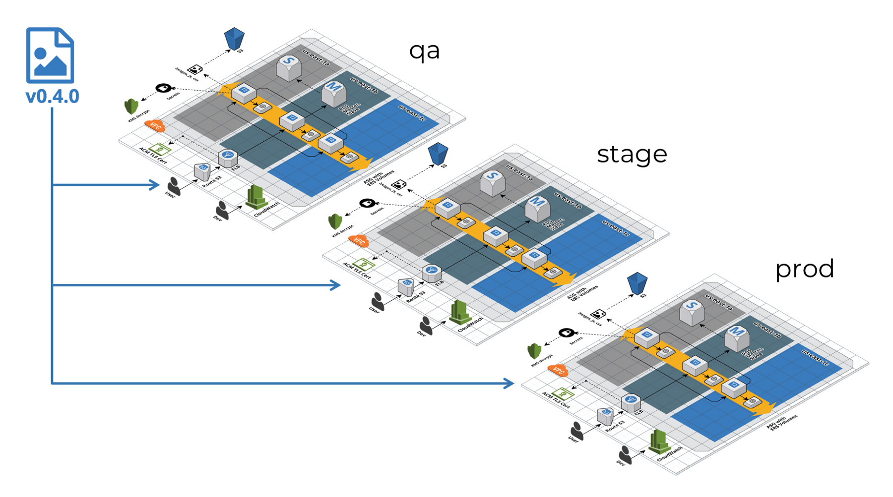

import { Aside } from '@astrojs/starlight/components';
import StatefulTabs from '@components/StatefulTabs.astro';
import FileTree from '@components/vendored/starlight/FileTree.astro';

The following is a simple overview of the main features in Terragrunt.

It includes configurations that are a bit more complex than the ones found in the [Quick Start](/getting-started/quick-start/), but don't panic!

We'll walk you through each one, and you don't need to understand everything right away. Knowing that these features are available as you start to use Terragrunt can give you a tool to reach for when you encounter common problems that typically require one or more of these solutions.

This guide is geared towards users who have either already gone through the [Quick Start](/getting-started/quick-start/) or are joining a team of users that are already using Terragrunt. As a consequence, we'll be using more complex configurations, discussing more advanced features, and showing how to use Terragrunt to manage real AWS or Azure infrastructure.

If you are unfamiliar with OpenTofu/Terraform, you may want to also read [OpenTofu](https://opentofu.org/docs/intro/) or [Terraform](https://developer.hashicorp.com/terraform/intro) documentation after reading this guide.

<Aside type="tip" title="AWS or Azure?">
The code samples on this page are provided for both AWS and Azure. Use the **AWS** and **Azure** tabs above each sample to switch between them. Switching one sample switches every sample on the page, and your choice is remembered as you move between pages.
</Aside>

## Following Along

What follows isn't a tutorial in the same sense as the [Quick Start](/getting-started/quick-start/), but more of a guided tour of some of the more commonly used features of Terragrunt. You don't need to follow along to understand the concepts, but if you want to, you can.

The code samples provided here are available as individual "steps" for [AWS](https://github.com/gruntwork-io/terragrunt/tree/main/test/fixtures/docs/02-overview) and [Azure](https://github.com/gruntwork-io/terragrunt/tree/main/test/fixtures/docs/02-overview-azure).

{/* NOTE: We also test these continuously in `test/integration_docs_aws_test.go` and `test/integration_docs_azure_test.go` */}

If you would prefer it, you can clone the [Terragrunt repository](https://github.com/gruntwork-io/terragrunt.git), and follow along with the examples in your own environment without any copy + paste.

Just make sure to replace the values prefixed `__FILL_IN_` with values relevant to your account.

If you don't have an AWS or Azure account, you can sign up for a free tier account at [aws.amazon.com](https://aws.amazon.com/) or [azure.microsoft.com](https://azure.microsoft.com/free/), or adapt the examples to use a different cloud provider.

## Example

Here is a typical `terragrunt.hcl` file you might find in a Terragrunt project\*:

<StatefulTabs syncKey="cloud-provider" tabs={['AWS', 'Azure']}>
<Fragment slot="aws">

```hcl
# terragrunt.hcl

# Configure the remote backend
remote_state {
  backend = "s3"

  generate = {
    path      = "backend.tf"
    if_exists = "overwrite_terragrunt"
  }

  config = {
    bucket = "my-tofu-state"

    key            = "tofu.tfstate"
    region         = "us-east-1"
    encrypt        = true
    dynamodb_table = "my-lock-table"
  }
}

# Configure the AWS provider
generate "provider" {
  path = "provider.tf"
  if_exists = "overwrite_terragrunt"
  contents = <<EOF
provider "aws" {
  region = "us-east-1"
}
EOF
}

# Configure the module
#
# The URL used here is a shorthand for
# "tfr://registry.terraform.io/terraform-aws-modules/vpc/aws?version=5.16.0".
#
# You can find the module at:
# https://registry.terraform.io/modules/terraform-aws-modules/vpc/aws/latest
#
# Note the extra `/` after the `tfr` protocol is required for the shorthand
# notation.
terraform {
  source = "tfr:///terraform-aws-modules/vpc/aws?version=5.16.0"
}

# Configure the inputs for the module
inputs = {
  name = "my-vpc"
  cidr = "10.0.0.0/16"

  azs             = ["us-east-1a", "us-east-1b", "us-east-1c"]
  private_subnets = ["10.0.1.0/24", "10.0.2.0/24", "10.0.3.0/24"]
  public_subnets  = ["10.0.101.0/24", "10.0.102.0/24", "10.0.103.0/24"]

  enable_nat_gateway = false
  enable_vpn_gateway = false

  tags = {
    IaC = "true"
    Environment = "dev"
  }
}
```

</Fragment>
<Fragment slot="azure">

```hcl
# terragrunt.hcl

# Configure the remote backend
remote_state {
  backend = "azurerm"

  generate = {
    path      = "backend.tf"
    if_exists = "overwrite_terragrunt"
  }

  config = {
    resource_group_name  = "my-tofu-state"
    storage_account_name = "mytofustate"
    container_name       = "tfstate"

    key                   = "tofu.tfstate"
    location              = "eastus"
    use_azuread_auth      = true
    assign_blob_data_role = true
  }
}

# Configure the Azure provider
generate "provider" {
  path = "provider.tf"
  if_exists = "overwrite_terragrunt"
  contents = <<EOF
provider "azapi" {
  default_location = "eastus"
}
EOF
}

# Configure the module
#
# The URL used here is a shorthand for
# "tfr://registry.terraform.io/Azure/avm-res-resources-resourcegroup/azurerm?version=0.4.0".
#
# You can find the module at:
# https://registry.terraform.io/modules/Azure/avm-res-resources-resourcegroup/azurerm/latest
#
# Note the extra `/` after the `tfr` protocol is required for the shorthand
# notation.
terraform {
  source = "tfr:///Azure/avm-res-resources-resourcegroup/azurerm?version=0.4.0"
}

# Configure the inputs for the module
inputs = {
  name     = "my-rg-eastus"
  location = "eastus"

  tags = {
    IaC = "true"
    Environment = "dev"
  }
}
```

</Fragment>
</StatefulTabs>

### Try it out

If you want to try this configuration locally:

<StatefulTabs syncKey="cloud-provider" tabs={['AWS', 'Azure']}>
<Fragment slot="aws">

1. Copy the contents above into a `terragrunt.hcl` file in an empty directory.
2. Change the value of `bucket` in the `remote_state` block to a unique name.

   This has to be globally unique, so you might want to include today's date in the name.

3. Ensure that you are authenticated with AWS and have the necessary permissions to create resources.

   Running `aws sts get-caller-identity` in the AWS CLI is a good way to confirm this.

4. Run `terragrunt apply --backend-bootstrap -auto-approve` in the directory where you created the `terragrunt.hcl` file.

</Fragment>
<Fragment slot="azure">

1. Copy the contents above into a `terragrunt.hcl` file in an empty directory.
2. Change the value of `storage_account_name` in the `remote_state` block to a unique name.

   Storage account names have to be globally unique, between 3 and 24 characters long, and can only contain lowercase letters and numbers.

3. Ensure that you are authenticated with Azure, and tell Terragrunt and OpenTofu/Terraform which subscription to use:

   ```bash
   az login
   export ARM_SUBSCRIPTION_ID="$(az account show --query id --output tsv)"
   ```

   The example sets `assign_blob_data_role = true`, so the identity you log in with needs permission to create role assignments on the storage account (for example, the **Owner** role on the subscription). If you don't have that, remove `assign_blob_data_role` from the configuration and grant yourself the **Storage Blob Data Contributor** role on the storage account instead. See the [Azure Storage backend](/features/units/state-backend/#azure-storage-azurerm-backend) documentation for details.

   The [Azure Verified Modules](https://azure.github.io/Azure-Verified-Modules/) used in this guide require OpenTofu/Terraform 1.9 or newer.

4. Run `terragrunt apply --backend-bootstrap -auto-approve` in the directory where you created the `terragrunt.hcl` file.

</Fragment>
</StatefulTabs>

The `--backend-bootstrap` flag tells Terragrunt that it's allowed to create the remote state resources described in the `remote_state` block if they don't exist yet. Terragrunt won't create cloud resources as a side effect of a run unless you opt in like this.

If you're familiar with OpenTofu/Terraform, this should be a pretty familiar experience.

For the most part, when you use Terragrunt, you are simply setting up configurations in `terragrunt.hcl` files that have analogues to what you would define with `.tf` files, then running `terragrunt` instead of `tofu`/`terraform` on the command line.

### `terragrunt.hcl`

The `terragrunt.hcl` file above does the following:

#### Remote state backend configuration

The `remote_state` configuration block controls how Terragrunt should store backend OpenTofu/Terraform state.

<StatefulTabs syncKey="cloud-provider" tabs={['AWS', 'Azure']}>
<Fragment slot="aws">

In this example, Terragrunt is being configured to store state in an S3 bucket named `my-tofu-state` in the `us-east-1` region. The state file will be named `tofu.tfstate`, and Terragrunt will use a DynamoDB table named `my-lock-table` for locking.

If you run the following, you can see how Terragrunt generates a `backend.tf` file to tell OpenTofu/Terraform to do this:

```bash
$ find .terragrunt-cache -name backend.tf -exec cat {} \;
# Generated by Terragrunt. Sig: nIlQXj57tbuaRZEa
terraform {
  backend "s3" {
    bucket         = "my-tofu-state"
    dynamodb_table = "my-lock-table"
    encrypt        = true
    key            = "tofu.tfstate"
    region         = "us-east-1"
  }
}
```

</Fragment>
<Fragment slot="azure">

In this example, Terragrunt is being configured to store state in a blob container named `tfstate`, in a storage account named `mytofustate` that lives in the `my-tofu-state` resource group. The state file will be named `tofu.tfstate`. Azure Blob Storage provides locking through blob leases, so no separate lock table is needed.

If you run the following, you can see how Terragrunt generates a `backend.tf` file to tell OpenTofu/Terraform to do this:

```bash
$ find .terragrunt-cache -name backend.tf -exec cat {} \;
# Generated by Terragrunt. Sig: nIlQXj57tbuaRZEa
terraform {
  backend "azurerm" {
    container_name       = "tfstate"
    key                  = "tofu.tfstate"
    resource_group_name  = "my-tofu-state"
    storage_account_name = "mytofustate"
    use_azuread_auth     = true
  }
}
```

Notice that `location` and `assign_blob_data_role` aren't in the generated file. Those settings are only used by Terragrunt when it bootstraps the backend, and are never passed on to OpenTofu/Terraform.

</Fragment>
</StatefulTabs>

Right before running any OpenTofu/Terraform command that might store state, Terragrunt will ensure that the appropriate `backend.tf` file is present in the working directory where OpenTofu/Terraform will run, so that state is persisted appropriately when `tofu`/`terraform` is invoked.

Note that while following the example above, you didn't need to manually create the remote state resources (the S3 bucket and DynamoDB table on AWS, or the resource group, storage account and container on Azure), or run `tofu/terraform init` to perform initialization. Because you passed `--backend-bootstrap`, Terragrunt created them for you.

These are just a few of the things that Terragrunt does automatically when orchestrating OpenTofu/Terraform commands because it knows how OpenTofu/Terraform work, and it can take care of some busy work for you to make your life easier.

#### Provider configuration

The `generate` block is used to inject arbitrary files into the OpenTofu/Terraform module before running any OpenTofu/Terraform commands.

<StatefulTabs syncKey="cloud-provider" tabs={['AWS', 'Azure']}>
<Fragment slot="aws">

In this example, Terragrunt is being configured to inject a `provider.tf` file into the module that configures the AWS provider to use the `us-east-1` region.

If you run the following, you can see the `provider.tf` file that Terragrunt generates:

```bash
$ find .terragrunt-cache -name provider.tf -exec cat {} \;
# Generated by Terragrunt. Sig: nIlQXj57tbuaRZEa
provider "aws" {
  region = "us-east-1"
}
```

</Fragment>
<Fragment slot="azure">

In this example, Terragrunt is being configured to inject a `provider.tf` file into the module that configures the [azapi](https://registry.terraform.io/providers/Azure/azapi/latest/docs) provider, which the Azure Verified Modules used in this guide are built on. Authentication comes from your Azure CLI session, and the target subscription from the `ARM_SUBSCRIPTION_ID` environment variable you exported earlier. The `default_location` is used by any resource that doesn't set a `location` of its own.

If you run the following, you can see the `provider.tf` file that Terragrunt generates:

```bash
$ find .terragrunt-cache -name provider.tf -exec cat {} \;
# Generated by Terragrunt. Sig: nIlQXj57tbuaRZEa
provider "azapi" {
  default_location = "eastus"
}
```

</Fragment>
</StatefulTabs>

This is the most common use case for the `generate` block, but you can use it to inject any file you want into the OpenTofu/Terraform module. This can be useful for injecting any configurations that aren't part of the generic module you want to reuse, or aren't easy to generate dynamically (such as `provider` blocks, which can't be dynamic in OpenTofu/Terraform). You can imagine that it may be convenient to have one set of modules, but dynamically inject different provider configurations based on the region you're deploying to, etc.

You want to be mindful not to do too much with this configuration block, as it can make your OpenTofu/Terraform code harder to reproduce, understand and maintain. But it can be a powerful tool when used judiciously.

#### Module configuration

The `terraform` block is used to indicate where to source the OpenTofu/Terraform module from (it's called `terraform` for historical reasons, but it controls behavior pertinent to both OpenTofu and Terraform).

In this example, all it is doing is controlling where Terragrunt should fetch the OpenTofu/Terraform module from. The configuration block [can do a lot more](/reference/hcl/blocks#terraform), but the `source` attribute is the most common attribute you'll set on the `terraform` block.

You'll notice that in the examples above, we were using `find` to locate the `.tf` files being generated and placed within the OpenTofu/Terraform module being downloaded here within the `.terragrunt-cache` directory. This is because Terragrunt aims to operate as an orchestrator, at a level of abstraction higher than OpenTofu/Terraform.

Over the years supporting customers managing IaC at scale, the patterns that we've seen emerge for really successful organizations is to treat OpenTofu/Terraform modules as versioned, generic, well tested patterns of infrastructure, and to deploy them in as close to the exact same way as possible across all uses of them.

Terragrunt supports this pattern by treating each [unit](/getting-started/terminology/#unit) of Terragrunt configuration (a directory with a `terragrunt.hcl` file in it) as a hermetic container of infrastructure that can be reasoned about in isolation, and then composed together to form a larger system of one or more [stacks](/getting-started/terminology/#stack) (each stack being a collection of units).

To that end, the way that Terragrunt loads OpenTofu/Terraform configurations is to download them into a subdirectory of the `.terragrunt-cache` directory, and then to orchestrate OpenTofu/Terraform commands from that directory. This ensures that the OpenTofu/Terraform modules are treated as immutable, versioned, and hermetic, and that the OpenTofu/Terraform runs are reliably reproducible.

<StatefulTabs syncKey="cloud-provider" tabs={['AWS', 'Azure']}>
<Fragment slot="aws">

<FileTree>

- .terragrunt-cache/
  - tnIp4Am20T3Q8-6FuPqfof-kRGU
    - ThyYwttwki6d6AS3aD5OwoyqIWA
      - CHANGELOG.md
      - LICENSE
      - README.md
      - UPGRADE-3.0.md
      - UPGRADE-4.0.md
      - backend.tf
      - examples
      - main.tf
      - modules
      - outputs.tf
      - provider.tf
      - terragrunt.hcl
      - variables.tf
      - versions.tf
      - vpc-flow-logs.tf

</FileTree>

</Fragment>
<Fragment slot="azure">

<FileTree>

- .terragrunt-cache/
  - tnIp4Am20T3Q8-6FuPqfof-kRGU
    - ThyYwttwki6d6AS3aD5OwoyqIWA
      - AGENTS.md
      - CODE_OF_CONDUCT.md
      - CONTRIBUTING.md
      - LICENSE
      - Makefile
      - README.md
      - SECURITY.md
      - SUPPORT.md
      - _footer.md
      - _header.md
      - avm
      - avm.bat
      - avm.ps1
      - avm.tflint.override.hcl
      - backend.tf
      - data.tf
      - examples
      - main.telemetry.tf
      - main.tf
      - modules
      - outputs.tf
      - provider.tf
      - terraform.tf
      - terragrunt.hcl
      - tests
      - variables.tf

</FileTree>

</Fragment>
</StatefulTabs>

Any file that isn't part of the OpenTofu/Terraform module (like the `backend.tf` and `provider.tf` files Terragrunt generated) get a special little `Generated by Terragrunt` comment at the top of their files by default to make sure it's clear that Terragrunt generated them (and that they might not be there for other users of the same module).

#### Inputs configuration

The `inputs` block is used to indicate what variable values should be passed to OpenTofu/Terraform when running `tofu`/`terraform` commands.

In this example, Terragrunt is being configured to pass in a bunch of variables to the OpenTofu/Terraform module. On AWS, these variables configure the VPC module: the name of the VPC, the CIDR block, the availability zones, the subnets, and so on. On Azure, they configure the resource group module: its name, location and tags.

Under the hood, what happens here is that Terragrunt sets relevant `TF_VAR_` prefixed environment variables, which are automatically detected by OpenTofu/Terraform as values for variables defined in `.tf` files.

#### Further Reading

You can learn more about all the configuration [blocks](/reference/hcl/blocks) and [attributes](/reference/hcl/attributes) available in Terragrunt in the docs.

## Core Patterns

This statement above is kind of a lie:

\*  Here is a typical `terragrunt.hcl` file you might find in a Terragrunt project.

The truth is, you'll almost never see configuration like that outside of some tests or examples. The reason for this is that one of the main responsibilities Terragrunt has is to scale IaC, and the configuration above would result in quite a lot of code duplication across a project. In an AWS or Azure project for example, you will probably use the same (or very similar) `provider` configuration across all your units, and you'll probably use the same `backend` configuration across all your units (with the only exception being the `key` for where in the state bucket or container your state should be stored).

Aware of this pattern, Terragrunt is designed to leverage a hierarchy of reusable configurations so that your code can be [DRY (Don't Repeat Yourself)](/getting-started/terminology#dont-repeat-yourself-dry).

### The `include` block

In almost every `terragrunt.hcl` file you see, there will be a section that looks like this:

```hcl
include "root" {
  path = find_in_parent_folders("root.hcl")
}
```

This block configures Terragrunt to _include_ configuration found in a parent folder named `root.hcl` into it. This is a way to share configuration across all units of infrastructure in your project.

The `root` _label_ being applied here is the idiomatic way to reference the `root.hcl` file that is common to all other configurations in the project. This is a convention, not a requirement, but it's a good one to follow to make your code more readable and maintainable.

Rewriting the example above to use the `include` block so that it looks more like the kind of thing you'd see in a real project would look like this:

<StatefulTabs syncKey="cloud-provider" tabs={['AWS', 'Azure']}>
<Fragment slot="aws">

```hcl
# root.hcl
remote_state {
  backend = "s3"

  generate = {
    path      = "backend.tf"
    if_exists = "overwrite_terragrunt"
  }

  config = {
    bucket = "my-tofu-state"

    key            = "tofu.tfstate"
    region         = "us-east-1"
    encrypt        = true
    dynamodb_table = "my-lock-table"
  }
}

generate "provider" {
  path = "provider.tf"
  if_exists = "overwrite_terragrunt"
  contents = <<EOF
provider "aws" {
  region = "us-east-1"
}
EOF
}
```

```hcl
# vpc/terragrunt.hcl
include "root" {
  path = find_in_parent_folders("root.hcl")
}

terraform {
  source = "tfr:///terraform-aws-modules/vpc/aws?version=5.16.0"
}

inputs = {
  name = "my-vpc"
  cidr = "10.0.0.0/16"

  azs             = ["us-east-1a", "us-east-1b", "us-east-1c"]
  private_subnets = ["10.0.1.0/24", "10.0.2.0/24", "10.0.3.0/24"]
  public_subnets  = ["10.0.101.0/24", "10.0.102.0/24", "10.0.103.0/24"]

  enable_nat_gateway = false
  enable_vpn_gateway = false

  tags = {
    IaC = "true"
    Environment = "dev"
  }
}
```

</Fragment>
<Fragment slot="azure">

```hcl
# root.hcl
remote_state {
  backend = "azurerm"

  generate = {
    path      = "backend.tf"
    if_exists = "overwrite_terragrunt"
  }

  config = {
    resource_group_name  = "my-tofu-state"
    storage_account_name = "mytofustate"
    container_name       = "tfstate"

    key                   = "tofu.tfstate"
    location              = "eastus"
    use_azuread_auth      = true
    assign_blob_data_role = true
  }
}

generate "provider" {
  path = "provider.tf"
  if_exists = "overwrite_terragrunt"
  contents = <<EOF
provider "azapi" {
  default_location = "eastus"
}
EOF
}
```

```hcl
# rg/terragrunt.hcl
include "root" {
  path = find_in_parent_folders("root.hcl")
}

terraform {
  source = "tfr:///Azure/avm-res-resources-resourcegroup/azurerm?version=0.4.0"
}

inputs = {
  name     = "my-rg-eastus"
  location = "eastus"

  tags = {
    IaC = "true"
    Environment = "dev"
  }
}
```

</Fragment>
</StatefulTabs>

By doing this, you can see that it's become easier to introduce new units of infrastructure, as you only need to define the unique parts of the configuration for that unit in the new `terragrunt.hcl` file. The shared configuration is inherited from the `root.hcl` file.

When you see `include` blocks in Terragrunt, remember that they result in the configuration being _inlined_ into the configuration file that includes them. For the most part, you can simply replace the relevant `include` block with the configuration it is including to see the full configuration that Terragrunt will use.

The exception to this is when you are using directives that explicitly leverage the fact that configurations are being included.

### Building out the stack

For example, say you wanted to add another unit of infrastructure into the _stack_ that you're building out here. You could create a new directory for it, and add a `terragrunt.hcl` file to it like this:

<StatefulTabs syncKey="cloud-provider" tabs={['AWS', 'Azure']}>
<Fragment slot="aws">

```hcl
# ec2/terragrunt.hcl
include "root" {
  path = find_in_parent_folders("root.hcl")
}

terraform {
  source = "tfr:///terraform-aws-modules/ec2-instance/aws?version=5.7.1"
}

dependency "vpc" {
  config_path = "../vpc"
}

inputs = {
  name = "single-instance"

  instance_type = "t2.micro"
  monitoring    = true
  subnet_id     = dependency.vpc.outputs.private_subnets[0]

  tags = {
    IaC         = "true"
    Environment = "dev"
  }
}
```

</Fragment>
<Fragment slot="azure">

```hcl
# vnet/terragrunt.hcl
include "root" {
  path = find_in_parent_folders("root.hcl")
}

terraform {
  source = "tfr:///Azure/avm-res-network-virtualnetwork/azurerm?version=0.22.3"
}

dependency "rg" {
  config_path = "../rg"
}

inputs = {
  name      = "my-vnet"
  location  = "eastus"
  parent_id = dependency.rg.outputs.resource_id

  address_space = ["10.0.0.0/16"]

  subnets = {
    private = {
      name             = "private"
      address_prefixes = ["10.0.1.0/24"]
    }
    public = {
      name             = "public"
      address_prefixes = ["10.0.101.0/24"]
    }
  }

  tags = {
    IaC         = "true"
    Environment = "dev"
  }
}
```

</Fragment>
</StatefulTabs>

### Key Collisions

If you tried to run `terragrunt plan` in that new directory, you'd see something alarming:

<StatefulTabs syncKey="cloud-provider" tabs={['AWS', 'Azure']}>
<Fragment slot="aws">

```bash
$ terragrunt plan
...
16:31:14.176 STDOUT tofu:   # aws_instance.this[0] will be created
...
16:31:14.178 STDOUT tofu:   # aws_subnet.private[0] will be destroyed
...
16:31:14.179 STDOUT tofu:   # aws_vpc.this[0] will be destroyed
...
16:31:14.179 STDOUT tofu: Plan: 4 to add, 0 to change, 22 to destroy.
```

</Fragment>
<Fragment slot="azure">

```bash
$ terragrunt plan
...
16:21:56.723 STDOUT tofu:   # azapi_resource.this will be destroyed
...
16:21:56.723 STDOUT tofu:   # azapi_resource.vnet will be created
...
16:21:56.723 STDOUT tofu:   # module.subnet["private"].azapi_resource.subnet[0] will be created
...
16:21:56.723 STDOUT tofu:   # module.subnet["public"].azapi_resource.subnet[0] will be created
...
16:21:56.724 STDOUT tofu: Plan: 3 to add, 0 to change, 1 to destroy.
```

</Fragment>
</StatefulTabs>

OpenTofu/Terraform wants to create the resources for the new unit, but it also wants to _destroy_ everything the first unit created. Don't apply this!

What's happening here is that when Terragrunt invoked OpenTofu/Terraform, it generated exactly the same `backend.tf` file for the new unit of infrastructure as it did for the first unit, so both units are using the same state file.

You can see that in the newly generated `backend.tf` file in the `.terragrunt-cache` directory under the new unit:

<StatefulTabs syncKey="cloud-provider" tabs={['AWS', 'Azure']}>
<Fragment slot="aws">

```bash
$ find .terragrunt-cache -name backend.tf -exec cat {} \;
# Generated by Terragrunt. Sig: nIlQXj57tbuaRZEa
terraform {
  backend "s3" {
    bucket         = "my-tofu-state"
    dynamodb_table = "my-lock-table"
    encrypt        = true
    key            = "tofu.tfstate"
    region         = "us-east-1"
  }
}
```

</Fragment>
<Fragment slot="azure">

```bash
$ find .terragrunt-cache -name backend.tf -exec cat {} \;
# Generated by Terragrunt. Sig: nIlQXj57tbuaRZEa
terraform {
  backend "azurerm" {
    container_name       = "tfstate"
    key                  = "tofu.tfstate"
    resource_group_name  = "my-tofu-state"
    storage_account_name = "mytofustate"
    use_azuread_auth     = true
  }
}
```

</Fragment>
</StatefulTabs>

### Dynamic keys

What most folks would really prefer here is to have the state for the new unit stored in a different, but predictable, location relative to the first unit.

The pattern that we've found to be most effective is to store state so that the location in the remote backend (an S3 bucket or an Azure Storage container) mirrors the location of the unit on the filesystem.

So this filesystem layout:

<StatefulTabs syncKey="cloud-provider" tabs={['AWS', 'Azure']}>
<Fragment slot="aws">

<FileTree>

- root.hcl
  - vpc
    - terragrunt.hcl
  - ec2
    - terragrunt.hcl

</FileTree>

Would result in this state layout in S3:

<FileTree>

- s3://my-tofu-state
  - vpc
    - tofu.tfstate
  - ec2
    - tofu.tfstate

</FileTree>

</Fragment>
<Fragment slot="azure">

<FileTree>

- root.hcl
  - rg
    - terragrunt.hcl
  - vnet
    - terragrunt.hcl

</FileTree>

Would result in this state layout in the `tfstate` container of the `mytofustate` storage account:

<FileTree>

- mytofustate
  - tfstate
    - rg
      - tofu.tfstate
    - vnet
      - tofu.tfstate

</FileTree>

</Fragment>
</StatefulTabs>

To achieve this, we can take advantage of the `path_relative_to_include()` Terragrunt HCL function to generate a `key` dynamically based on the position of the unit relative to the `root.hcl` file within the filesystem.

<StatefulTabs syncKey="cloud-provider" tabs={['AWS', 'Azure']}>
<Fragment slot="aws">

```hcl
# root.hcl
remote_state {
  backend = "s3"

  generate = {
    path      = "backend.tf"
    if_exists = "overwrite_terragrunt"
  }

  config = {
    bucket = "my-tofu-state"

    key            = "${path_relative_to_include()}/tofu.tfstate" # <--
    region         = "us-east-1"
    encrypt        = true
    dynamodb_table = "my-lock-table"
  }
}

generate "provider" {
  path = "provider.tf"
  if_exists = "overwrite_terragrunt"
  contents = <<EOF
provider "aws" {
  region = "us-east-1"
}
EOF
}
```

</Fragment>
<Fragment slot="azure">

```hcl
# root.hcl
remote_state {
  backend = "azurerm"

  generate = {
    path      = "backend.tf"
    if_exists = "overwrite_terragrunt"
  }

  config = {
    resource_group_name  = "my-tofu-state"
    storage_account_name = "mytofustate"
    container_name       = "tfstate"

    key                   = "${path_relative_to_include()}/tofu.tfstate" # <--
    location              = "eastus"
    use_azuread_auth      = true
    assign_blob_data_role = true
  }
}

generate "provider" {
  path = "provider.tf"
  if_exists = "overwrite_terragrunt"
  contents = <<EOF
provider "azapi" {
  default_location = "eastus"
}
EOF
}
```

</Fragment>
</StatefulTabs>

What this does is set the `key` attribute of the generated `backend.tf` file to be the relative path from the `root.hcl` file to the `terragrunt.hcl` file that is being processed.

### Migrating state

You have to be careful when adjusting the `key` attribute of units (including when moving units around in the filesystem, if you use something like `path_relative_to_include` to drive the value of the `key` attribute) because it can result in state being stored in a different location in the remote backend.

There's native tooling in OpenTofu/Terraform to support these procedures, but you want to be confident you know what you're doing when you run them. By default, Terragrunt will provision a remote backend that uses versioning, so you can always roll back to a previous state if you need to.

<StatefulTabs syncKey="cloud-provider" tabs={['AWS', 'Azure']}>
<Fragment slot="aws">

```bash
# Within the vpc directory
# First, we'll migrate state to the new location
$ terragrunt init -migrate-state
# Then, let's take a look at the generated backend.tf file
$ find .terragrunt-cache -name backend.tf -exec cat {} \;
# Generated by Terragrunt. Sig: nIlQXj57tbuaRZEa
terraform {
  backend "s3" {
    bucket         = "my-tofu-state"
    dynamodb_table = "my-lock-table"
    encrypt        = true
    key            = "vpc/tofu.tfstate"
    region         = "us-east-1"
  }
}
```

The `ec2` unit was initialized against the shared key, so it has to be re-initialized against its own key before it can be planned. There is nothing to migrate for it, as it has never been applied:

```bash
# Within the ec2 directory
$ terragrunt init -reconfigure
```

Now, we can run the plan in the `ec2` directory without any issues:

```bash
# Within the ec2 directory
$ terragrunt plan
...
$ find .terragrunt-cache -name backend.tf -exec cat {} \;
# Generated by Terragrunt. Sig: nIlQXj57tbuaRZEa
terraform {
  backend "s3" {
    bucket         = "my-tofu-state"
    dynamodb_table = "my-lock-table"
    encrypt        = true
    key            = "ec2/tofu.tfstate"
    region         = "us-east-1"
  }
}
```

</Fragment>
<Fragment slot="azure">

```bash
# Within the rg directory
# First, we'll migrate state to the new location
$ terragrunt init -migrate-state
# Then, let's take a look at the generated backend.tf file
$ find .terragrunt-cache -name backend.tf -exec cat {} \;
# Generated by Terragrunt. Sig: nIlQXj57tbuaRZEa
terraform {
  backend "azurerm" {
    container_name       = "tfstate"
    key                  = "rg/tofu.tfstate"
    resource_group_name  = "my-tofu-state"
    storage_account_name = "mytofustate"
    use_azuread_auth     = true
  }
}
```

The `vnet` unit was initialized against the shared key, so it has to be re-initialized against its own key before it can be planned. There is nothing to migrate for it, as it has never been applied:

```bash
# Within the vnet directory
$ terragrunt init -reconfigure
```

Now, we can run the plan in the `vnet` directory without any issues:

```bash
# Within the vnet directory
$ terragrunt plan
...
$ find .terragrunt-cache -name backend.tf -exec cat {} \;
# Generated by Terragrunt. Sig: nIlQXj57tbuaRZEa
terraform {
  backend "azurerm" {
    container_name       = "tfstate"
    key                  = "vnet/tofu.tfstate"
    resource_group_name  = "my-tofu-state"
    storage_account_name = "mytofustate"
    use_azuread_auth     = true
  }
}
```

</Fragment>
</StatefulTabs>

Note that `init -migrate-state` copies the state to its new key, but leaves the original behind at the old `tofu.tfstate` key. It's harmless, but you may want to delete it once you've confirmed the migration worked.

Following this pattern, you can create as many units of infrastructure in your project as you like without worrying about collisions in remote state keys.

Note that while this is the idiomatic approach for defining the `key` attribute for your `backend` configuration, it is not a requirement. You can set the `key` attribute to any value you like, and you can use any Terragrunt HCL function to generate that value dynamically such that you avoid collisions in your remote state.

Another completely valid approach, for example, is to utilize [get_repo_root](/reference/hcl/functions#get_repo_root), which returns a path relative to the root of the git repository. This, of course, has the drawback that it will not work if you are not using git.

Just make sure to test your configuration carefully, and document your approach so that others can understand what you're doing.

### The `dependency` block

You might have noticed that the second unit of infrastructure has a `dependency` block in its configuration:

<StatefulTabs syncKey="cloud-provider" tabs={['AWS', 'Azure']}>
<Fragment slot="aws">

```hcl
# ec2/terragrunt.hcl
# ...
dependency "vpc" {
  config_path = "../vpc"
}

inputs = {
  name = "single-instance"

  instance_type = "t2.micro"
  monitoring    = true
  subnet_id     = dependency.vpc.outputs.private_subnets[0]

  tags = {
    IaC         = "true"
    Environment = "dev"
  }
}
```

This block tells Terragrunt that the `ec2` unit _depends_ on the output of the `vpc` unit. You can also see that it references that dependency within the `inputs` block as `dependency.vpc.outputs.private_subnets[0]`.

</Fragment>
<Fragment slot="azure">

```hcl
# vnet/terragrunt.hcl
# ...
dependency "rg" {
  config_path = "../rg"
}

inputs = {
  name      = "my-vnet"
  location  = "eastus"
  parent_id = dependency.rg.outputs.resource_id

  # ...
}
```

This block tells Terragrunt that the `vnet` unit _depends_ on the output of the `rg` unit. You can also see that it references that dependency within the `inputs` block as `dependency.rg.outputs.resource_id`.

</Fragment>
</StatefulTabs>

When Terragrunt is performing a run for a dependency, it will first run `terragrunt output` in the dependency, then expose the values from that output as values that can be used in the dependent unit.

This is a very useful mechanism, as it keeps each unit isolated, while allowing for message passing between units when they need to interact.

### The Directed Acyclic Graph (DAG)

Dependencies also give Terragrunt a way to reason about the order in which units of infrastructure should be run. It uses what's called a [Directed Acyclic Graph (DAG)](/getting-started/terminology/#directed-acyclic-graph-dag) to determine the order in which units should be run, and then runs them in that order.

For example, let's go ahead and destroy all the infrastructure that we've created so far:

<StatefulTabs syncKey="cloud-provider" tabs={['AWS', 'Azure']}>
<Fragment slot="aws">

```bash
# From the root directory
$ terragrunt run --all destroy
16:32:08.944 INFO   The following units will be run, starting with dependents and then their dependencies:
.
╰── ec2
    ╰── vpc
WARNING: Are you sure you want to run `terragrunt destroy` in each unit of the run queue displayed above? There is no undo! (y/n)
```

</Fragment>
<Fragment slot="azure">

```bash
# From the root directory
$ terragrunt run --all destroy
16:32:08.944 INFO   The following units will be run, starting with dependents and then their dependencies:
.
╰── vnet
    ╰── rg
WARNING: Are you sure you want to run `terragrunt destroy` in each unit of the run queue displayed above? There is no undo! (y/n)
```

</Fragment>
</StatefulTabs>

First, notice that we're using a special `run --all` command for Terragrunt. This command tells Terragrunt that we're operating on a stack of units, and that we want to run a given OpenTofu/Terraform command on all of them.

Second, notice that the dependent unit is listed first, and is run _before_ the unit it depends on. Terragrunt knows about the dependency, so it plans to run the dependent unit first, followed by its dependency.

This is a simple example, but as you build out more complex stacks of infrastructure, you'll find that Terragrunt's dependency resolution is a powerful tool for getting infrastructure provisioned correctly.

Go ahead and answer `y` to the prompt to allow destruction to proceed, and notice that the logging has also changed slightly:

<StatefulTabs syncKey="cloud-provider" tabs={['AWS', 'Azure']}>
<Fragment slot="aws">

```txt
16:33:28.820 STDOUT [ec2] tofu: aws_instance.this[0]: Destruction complete after 1m11s
16:33:28.936 STDOUT [ec2] tofu:
16:33:28.936 STDOUT [ec2] tofu: Destroy complete! Resources: 1 destroyed.
16:33:28.936 STDOUT [ec2] tofu:
16:33:30.713 STDOUT [vpc] tofu: aws_vpc.this[0]: Refreshing state... [id=vpc-063d11b72a2c9f8b3]
16:33:31.510 STDOUT [vpc] tofu: aws_default_security_group.this[0]: Refreshing state... [id=sg-060d402b95a2cd935]
16:33:31.511 STDOUT [vpc] tofu: aws_default_route_table.default[0]: Refreshing state... [id=rtb-05adb3ee7f48640f0]
```

</Fragment>
<Fragment slot="azure">

```txt
16:29:09.531 STDOUT [vnet] tofu: azapi_resource.vnet: Destruction complete after 12s
16:29:10.149 STDOUT [vnet] tofu: Destroy complete! Resources: 7 destroyed.
16:29:14.379 STDOUT [rg] tofu: azapi_resource.this: Refreshing state... [id=/subscriptions/00000000-0000-0000-0000-000000000000/resourceGroups/my-rg-eastus]
16:29:15.504 STDOUT [rg] tofu: azapi_resource.this: Destroying... [id=/subscriptions/00000000-0000-0000-0000-000000000000/resourceGroups/my-rg-eastus]
16:29:33.808 STDOUT [rg] tofu: azapi_resource.this: Destruction complete after 18s
16:29:34.421 STDOUT [rg] tofu: Destroy complete! Resources: 5 destroyed.
```

</Fragment>
</StatefulTabs>

Terragrunt will give you the contextual information you need to understand what's happening in your stack as it's being run. That `[ec2]` and `[vpc]` (or `[vnet]` and `[rg]`) prefix is a great way to quickly disambiguate what's happening in one unit of infrastructure from another.

### Mock outputs

Now that the stack has been destroyed, take a look at the error you get when you try to run `terragrunt run --all plan` again:

<StatefulTabs syncKey="cloud-provider" tabs={['AWS', 'Azure']}>
<Fragment slot="aws">

```bash
$ terragrunt run --all plan
...
16:50:22.677 ERROR  [ec2] Error: Unknown variable
16:50:22.677 ERROR  [ec2]   on /path/to/project/ec2/terragrunt.hcl line 19:
16:50:22.677 ERROR  [ec2]   19:   subnet_id     = dependency.vpc.outputs.private_subnets[0]
16:50:22.677 ERROR  [ec2] There is no variable named "dependency".
16:50:22.678 ERROR  Run failed: 2 errors occurred:

* resolving dependency "vpc" outputs: /path/to/project/vpc/terragrunt.hcl is a dependency of /path/to/project/ec2/terragrunt.hcl but detected no outputs. Either the target module has not been applied yet, or the module has no outputs.

  If this dependency is accessed before the outputs are ready (which can happen during the planning phase of an unapplied stack), consider using mock_outputs:

  dependency "vpc" {
      config_path = "../vpc"

      mock_outputs = {
          vpc_output = "mock-vpc-output"
      }
  }
...
```

</Fragment>
<Fragment slot="azure">

```bash
$ terragrunt run --all plan
...
16:50:22.677 ERROR  [vnet] Error: Unknown variable
16:50:22.677 ERROR  [vnet]   on /path/to/project/vnet/terragrunt.hcl line 17:
16:50:22.677 ERROR  [vnet]   17:   parent_id = dependency.rg.outputs.resource_id
16:50:22.677 ERROR  [vnet] There is no variable named "dependency".
16:50:22.678 ERROR  Run failed: 2 errors occurred:

* resolving dependency "rg" outputs: /path/to/project/rg/terragrunt.hcl is a dependency of /path/to/project/vnet/terragrunt.hcl but detected no outputs. Either the target module has not been applied yet, or the module has no outputs.

  If this dependency is accessed before the outputs are ready (which can happen during the planning phase of an unapplied stack), consider using mock_outputs:

  dependency "rg" {
      config_path = "../rg"

      mock_outputs = {
          rg_output = "mock-rg-output"
      }
  }
...
```

</Fragment>
</StatefulTabs>

The error emitted here tells us that the dependency doesn't have any outputs available yet for the dependent unit to consume, so the `dependency.*.outputs` reference can't be resolved.

The pattern most commonly used to address this is to simply mock the unavailable output during plans.

Adjust the `dependency` block in the dependent unit like so:

<StatefulTabs syncKey="cloud-provider" tabs={['AWS', 'Azure']}>
<Fragment slot="aws">

```hcl
# ec2/terragrunt.hcl
# ...
dependency "vpc" {
  config_path = "../vpc"

  mock_outputs = {
    private_subnets = ["mock-subnet"]
  }

  mock_outputs_allowed_terraform_commands = ["plan"]
}
# ...
```

</Fragment>
<Fragment slot="azure">

```hcl
# vnet/terragrunt.hcl
# ...
dependency "rg" {
  config_path = "../rg"

  mock_outputs = {
    resource_id = "/subscriptions/00000000-0000-0000-0000-000000000000/resourceGroups/mock-rg"
  }

  mock_outputs_allowed_terraform_commands = ["plan"]
}
# ...
```

</Fragment>
</StatefulTabs>

Then run the plan again:

<StatefulTabs syncKey="cloud-provider" tabs={['AWS', 'Azure']}>
<Fragment slot="aws">

```bash
$ terragrunt run --all plan
...
16:53:04.037 STDOUT [ec2] tofu:       + source_dest_check                    = true
16:53:04.037 STDOUT [ec2] tofu:       + spot_instance_request_id             = (known after apply)
16:53:04.037 STDOUT [ec2] tofu:       + subnet_id                            = "mock-subnet"
16:53:04.037 STDOUT [ec2] tofu:       + tags                                 = {
16:53:04.038 STDOUT [ec2] tofu:           + "Environment" = "dev"
...
```

</Fragment>
<Fragment slot="azure">

```bash
$ terragrunt run --all plan
...
16:30:34.850 WARN   [vnet] Config /path/to/project/rg/terragrunt.hcl is a dependency of /path/to/project/vnet/terragrunt.hcl that has no outputs, but mock outputs provided and returning those in dependency output.
...
16:30:39.449 STDOUT [vnet] tofu:   # azapi_resource.vnet will be created
16:30:39.449 STDOUT [vnet] tofu:   + resource "azapi_resource" "vnet" {
16:30:39.449 STDOUT [vnet] tofu:       + id                        = (known after apply)
16:30:39.450 STDOUT [vnet] tofu:       + location                  = "eastus"
16:30:39.450 STDOUT [vnet] tofu:       + name                      = "my-vnet"
16:30:39.450 STDOUT [vnet] tofu:       + parent_id                 = "/subscriptions/00000000-0000-0000-0000-000000000000/resourceGroups/mock-rg"
...
```

</Fragment>
</StatefulTabs>

As you can see, the plan for the dependent unit now includes the mock value we provided in the `mock_outputs` block.

Terragrunt only uses these mock values when the output is unavailable, so a `terragrunt run --all apply` would succeed, but it's best practice to explicitly tell Terragrunt that it should only use these mock values during a plan (or any other command where you are okay with the output being mocked).

Also note that when you run `terragrunt run --all apply`:

<StatefulTabs syncKey="cloud-provider" tabs={['AWS', 'Azure']}>
<Fragment slot="aws">

```bash
$ terragrunt run --all apply
16:57:32.297 INFO   The following units will be run, starting with dependencies and then their dependents:
.
╰── vpc
    ╰── ec2
Are you sure you want to run 'terragrunt apply' in each unit of the run queue displayed above? (y/n)
```

</Fragment>
<Fragment slot="azure">

```bash
$ terragrunt run --all apply
16:57:32.297 INFO   The following units will be run, starting with dependencies and then their dependents:
.
╰── rg
    ╰── vnet
Are you sure you want to run 'terragrunt apply' in each unit of the run queue displayed above? (y/n)
```

</Fragment>
</StatefulTabs>

That the order of units has flipped. Terragrunt knows that during applies, dependencies actually need to be run _before_ the dependent unit, so it's flipped the order of the units in the stack, relative to destroys.

You can answer `y` to allow the apply to proceed and see that the dependent unit is given the real output of its dependency (not the mock value) as expected.

### Configuration hierarchy

Terragrunt also provides tooling for constructing a hierarchy of configurations that can be used to manage multiple environments, regions, or accounts.

Say, for example, you wanted to provision the same resources you've provisioned so far, but in multiple regions, with a filesystem layout like this:

<StatefulTabs syncKey="cloud-provider" tabs={['AWS', 'Azure']}>
<Fragment slot="aws">

<FileTree>

- root.hcl
- us-east-1
  - vpc
    - terragrunt.hcl
  - ec2
    - terragrunt.hcl
- us-west-2
  - vpc
    - terragrunt.hcl
  - ec2
    - terragrunt.hcl

</FileTree>

</Fragment>
<Fragment slot="azure">

<FileTree>

- root.hcl
- eastus
  - rg
    - terragrunt.hcl
  - vnet
    - terragrunt.hcl
- westus2
  - rg
    - terragrunt.hcl
  - vnet
    - terragrunt.hcl

</FileTree>

</Fragment>
</StatefulTabs>

With Terragrunt, that's pretty easy to achieve. You would first create a directory for the region you've been deploying to so far, and copy the units you've created so far into it:

<StatefulTabs syncKey="cloud-provider" tabs={['AWS', 'Azure']}>
<Fragment slot="aws">

```bash
mkdir us-east-1
cp -R vpc ec2 us-east-1/
```

</Fragment>
<Fragment slot="azure">

```bash
mkdir eastus
cp -R rg vnet eastus/
```

</Fragment>
</StatefulTabs>

Moving a unit changes the value of `path_relative_to_include()`, and with it the key where its state is stored, so the state has to move too. The [`backend migrate`](/reference/cli/commands/backend/migrate/) command does that for you. Migrate dependencies before their dependents, then remove the old copies:

<StatefulTabs syncKey="cloud-provider" tabs={['AWS', 'Azure']}>
<Fragment slot="aws">

```bash
terragrunt backend migrate vpc us-east-1/vpc
terragrunt backend migrate ec2 us-east-1/ec2
rm -rf vpc ec2
```

</Fragment>
<Fragment slot="azure">

```bash
terragrunt backend migrate rg eastus/rg
terragrunt backend migrate vnet eastus/vnet
rm -rf rg vnet
```

</Fragment>
</StatefulTabs>

We want the region used by our units to be determined dynamically, so we can add a configuration file to the new region directory that looks like this:

<StatefulTabs syncKey="cloud-provider" tabs={['AWS', 'Azure']}>
<Fragment slot="aws">

```hcl
# us-east-1/region.hcl
locals {
  region = "us-east-1"
}
```

</Fragment>
<Fragment slot="azure">

```hcl
# eastus/region.hcl
locals {
  region = "eastus"
}
```

</Fragment>
</StatefulTabs>

Then update the `root.hcl` like so:

<StatefulTabs syncKey="cloud-provider" tabs={['AWS', 'Azure']}>
<Fragment slot="aws">

```hcl
# root.hcl
locals {
  region_hcl = find_in_parent_folders("region.hcl")
  region     = read_terragrunt_config(local.region_hcl).locals.region
}

# Configure the remote backend
remote_state {
  backend = "s3"
  generate = {
    path      = "backend.tf"
    if_exists = "overwrite_terragrunt"
  }
  config = {
    bucket = "my-tofu-state"

    key            = "${path_relative_to_include()}/tofu.tfstate"
    region         = "us-east-1"
    encrypt        = true
    dynamodb_table = "my-lock-table"
  }
}

# Configure the AWS provider
generate "provider" {
  path = "provider.tf"
  if_exists = "overwrite_terragrunt"
  contents = <<EOF
provider "aws" {
  region = "${local.region}"
}
EOF
}
```

Now, when the configurations in the `us-east-1` directory include the `root.hcl`, they'll automatically parse the first `region.hcl` file they find while traversing up the filesystem, and use the `region` value defined in that file to set the AWS region for the provider.

</Fragment>
<Fragment slot="azure">

```hcl
# root.hcl
locals {
  region_hcl = find_in_parent_folders("region.hcl")
  region     = read_terragrunt_config(local.region_hcl).locals.region
}

# Configure the remote backend
remote_state {
  backend = "azurerm"
  generate = {
    path      = "backend.tf"
    if_exists = "overwrite_terragrunt"
  }
  config = {
    resource_group_name  = "my-tofu-state"
    storage_account_name = "mytofustate"
    container_name       = "tfstate"

    key                   = "${path_relative_to_include()}/tofu.tfstate"
    location              = "eastus"
    use_azuread_auth      = true
    assign_blob_data_role = true
  }
}

# Configure the Azure provider
generate "provider" {
  path = "provider.tf"
  if_exists = "overwrite_terragrunt"
  contents = <<EOF
provider "azapi" {
  default_location = "${local.region}"
}
EOF
}
```

Now, when the configurations in the `eastus` directory include the `root.hcl`, they'll automatically parse the first `region.hcl` file they find while traversing up the filesystem, and use the `region` value defined in that file to set the default location for the provider.

The provider's `default_location` only applies to resources that don't set a `location` of their own. The modules used in this guide always set it explicitly, so the next section shows how to make the units pick up the region as well.

</Fragment>
</StatefulTabs>

**NOTE** In the generate block, we're using `"${local.region}"`, rather than `local.region`. This is because the `generate` block is going to generate a file directly into the OpenTofu/Terraform module. We need to ensure that when the value is interpolated, it's done so in a way that OpenTofu/Terraform can understand, so we wrap it in quotes.

**ALSO NOTE** The `remote_state` block is still storing all state in a single region by design. We don't have to do this, and you could easily set it to store state in multiple regions. For the sake of simplicity, and demonstration, we're keeping it in one region.

### Exposed includes

Before moving on, take note of one thing: some values in the units are still tied to the first region.

<StatefulTabs syncKey="cloud-provider" tabs={['AWS', 'Azure']}>
<Fragment slot="aws">

The `azs` attribute in the `vpc` unit of the `us-east-1` stack is hardcoded to `["us-east-1a", "us-east-1b", "us-east-1c"]`.

This would cause issues if we were to try to deploy the `vpc` unit in the `us-west-2` stack, as those availability zones don't exist in the `us-west-2` region. What we need to do is make the `azs` attribute dynamic and use the resolved region to determine the correct availability zones.

</Fragment>
<Fragment slot="azure">

The `location` input in both the `rg` and `vnet` units of the `eastus` stack is hardcoded to `"eastus"`, and the resource group is named `my-rg-eastus`.

If we copied those units into a `westus2` stack as-is, they would still create resources in `eastus`, and the second resource group would collide with the first (resource group names are unique within a subscription). What we need to do is make the `location` input and the resource group name dynamic, using the resolved region.

</Fragment>
</StatefulTabs>

To do this, we can _expose_ the attributes on the included `root` configuration by setting the `expose` attribute to `true`:

<StatefulTabs syncKey="cloud-provider" tabs={['AWS', 'Azure']}>
<Fragment slot="aws">

```hcl
# us-east-1/vpc/terragrunt.hcl
include "root" {
  path   = find_in_parent_folders("root.hcl")
  expose = true
}

locals {
  region = include.root.locals.region
}

# Configure the module
# The URL used here is a shorthand for
# "tfr://registry.terraform.io/terraform-aws-modules/vpc/aws?version=5.16.0".
# Note the extra `/` after the protocol is required for the shorthand
# notation.
terraform {
  source = "tfr:///terraform-aws-modules/vpc/aws?version=5.16.0"
}

# Configure the inputs for the module
inputs = {
  name = "my-vpc"
  cidr = "10.0.0.0/16"

  azs             = ["${local.region}a", "${local.region}b", "${local.region}c"] # <--
  private_subnets = ["10.0.1.0/24", "10.0.2.0/24", "10.0.3.0/24"]
  public_subnets  = ["10.0.101.0/24", "10.0.102.0/24", "10.0.103.0/24"]

  enable_nat_gateway = false
  enable_vpn_gateway = false

  tags = {
    IaC = "true"
    Environment = "dev"
  }
}
```

</Fragment>
<Fragment slot="azure">

```hcl
# eastus/rg/terragrunt.hcl
include "root" {
  path   = find_in_parent_folders("root.hcl")
  expose = true
}

locals {
  region = include.root.locals.region
}

terraform {
  source = "tfr:///Azure/avm-res-resources-resourcegroup/azurerm?version=0.4.0"
}

inputs = {
  name     = "my-rg-${local.region}" # <--
  location = local.region            # <--

  tags = {
    IaC = "true"
    Environment = "dev"
  }
}
```

```hcl
# eastus/vnet/terragrunt.hcl
include "root" {
  path   = find_in_parent_folders("root.hcl")
  expose = true
}

locals {
  region = include.root.locals.region
}

terraform {
  source = "tfr:///Azure/avm-res-network-virtualnetwork/azurerm?version=0.22.3"
}

dependency "rg" {
  config_path = "../rg"

  mock_outputs = {
    resource_id = "/subscriptions/00000000-0000-0000-0000-000000000000/resourceGroups/mock-rg"
  }

  mock_outputs_allowed_terraform_commands = ["plan"]
}

inputs = {
  name      = "my-vnet"
  location  = local.region # <--
  parent_id = dependency.rg.outputs.resource_id

  address_space = ["10.0.0.0/16"]

  subnets = {
    private = {
      name             = "private"
      address_prefixes = ["10.0.1.0/24"]
    }
    public = {
      name             = "public"
      address_prefixes = ["10.0.101.0/24"]
    }
  }

  tags = {
    IaC         = "true"
    Environment = "dev"
  }
}
```

</Fragment>
</StatefulTabs>

This makes it so that those values are determined dynamically based on the region that the unit is being deployed to.

Run `terragrunt run --all plan` from the region directory to confirm it. Both units should report no changes, as the dynamic values resolve to exactly what was hardcoded before.

Now that you've set up the first region, you can repeat the process for a second one:

<StatefulTabs syncKey="cloud-provider" tabs={['AWS', 'Azure']}>
<Fragment slot="aws">

```bash
cp -R us-east-1/ us-west-2/
```

Then update the `region.hcl` file in the `us-west-2` directory to set the region to `us-west-2`:

```hcl
# us-west-2/region.hcl
locals {
  region = "us-west-2"
}
```

</Fragment>
<Fragment slot="azure">

```bash
cp -R eastus/ westus2/
```

Then update the `region.hcl` file in the `westus2` directory to set the region to `westus2`:

```hcl
# westus2/region.hcl
locals {
  region = "westus2"
}
```

</Fragment>
</StatefulTabs>

### Tightening the blast radius

Run the `terragrunt run --all apply` command after changing your current working directory to the second region's directory:

<StatefulTabs syncKey="cloud-provider" tabs={['AWS', 'Azure']}>
<Fragment slot="aws">

```bash
cd us-west-2
terragrunt run --all apply
```

You should see the VPC and EC2 instances being provisioned in the `us-west-2` region.

</Fragment>
<Fragment slot="azure">

```bash
cd westus2
terragrunt run --all apply
```

You should see the resource group and virtual network being provisioned in the `westus2` region.

</Fragment>
</StatefulTabs>

This showcases three superpowers you gain when you leverage Terragrunt:

1. **Automatic DAG Resolution**: No configuration file had to be updated or modified to ensure that the dependent unit was run after the unit it depends on when provisioning the second stack. Terragrunt automatically resolved the dependency graph and ran the units in the correct order.
2. **Dynamic Configuration**: The code you copied from the first region's directory to the second didn't need to be modified at all to provision resources in a different region (with the exception of naming the region in the `region.hcl` file). Terragrunt was able to dynamically resolve the correct configuration based on context, and apply it to the OpenTofu/Terraform modules as generic patterns of infrastructure.
3. **Reduced Blast Radius**: By applying Terragrunt within the second region's directory, you were able to confidently target only the resources in that region, without affecting the resources in the first region. This is a powerful tool for safely managing multiple environments, regions, or accounts with a single codebase. Your current working directory when using Terragrunt is your [blast radius](/getting-started/terminology/#blast-radius), and Terragrunt makes it easy to manage that blast radius effectively.

### Cleanup

If you still have all the resources that were provisioned as part of this tutorial active, this is a reminder that you might want to clean them up.

To destroy all the resources you've provisioned thus far, run the following:

```bash
# From the root directory
$ terragrunt run --all destroy
```

In real-world scenarios, it's generally advised that you plan your destroys first before cleaning them up:

```bash
# From the root directory
$ terragrunt run --all -- plan -destroy
```

You won't need to run any more Terragrunt commands for the rest of this guide.

### Recommended Repository Patterns

Outside of the patterns used for setting up Terragrunt configurations within a project, there are also some patterns that we recommend for managing one or more repositories used to manage infrastructure. At Gruntwork, we refer to this as your "Infrastructure Estate".

These recommendations are merely guidelines, and you should adapt them to suit your team's needs and constraints.

#### `infrastructure-live`

The core of the infrastructure you manage with a Terragrunt is typically stored in a repository named `infrastructure-live` (or some variant of it). This repository is where you store the Terragrunt configurations used for infrastructure that is intended to be "live" (i.e. provisioned and active).

Most successful teams stick to [Trunk Based Development](https://trunkbaseddevelopment.com/), perform plans on any change being proposed via a pull request / merge request, and only apply changes to live infrastructure after a successful plan and review.

This repository is generally concerned with the configuration of reliably reproducible, immutable and versioned infrastructure. You generally don't author OpenTofu/Terraform code directly into it, and you apply appropriate branch protection rules to ensure that changes are merged only if they get the appropriate sign-off from responsible parties.

What's on the default branch for this repository is generally considered the source of truth for the infrastructure you have provisioned. That default branch is generally the only version that matters when considering the state of your infrastructure.

You can see an example of this in the [terragrunt-infrastructure-live-stacks-example](https://github.com/gruntwork-io/terragrunt-infrastructure-live-stacks-example) repository maintained by Gruntwork.

#### `infrastructure-modules`

The patterns for your infrastructure you want to reliably reproduce. This repository is where you store the OpenTofu/Terraform modules that you use in your `infrastructure-live` repository.

This repository is generally concerned with maintaining versioned, well tested and vetted patterns of infrastructure, ready to be consumed by the `infrastructure-live` repository.

You typically integrate this repository with tools like [Terratest](https://terratest.gruntwork.io/) to ensure that every change to a module is well tested and reliable.

[Semantic Versioning](https://semver.org/) is widely used to manage communicating the impact of updates to this repository, and you typically pin the version of a consumed module in the `infrastructure-live` repository to a specific tag.

You can see an example of this in the [terragrunt-infrastructure-catalog-example](https://github.com/gruntwork-io/terragrunt-infrastructure-catalog-example) repository maintained by Gruntwork.

### Atomic Deployments

Following the repository patterns outlined above, you typically see Terragrunt repositories that have configurations which look like this:

```hcl
# infrastructure-live/qa/app/terragrunt.hcl
include "root" {
  path = find_in_parent_folders("root.hcl")
}

terraform {
  source = "github.com:foo/infrastructure-modules.git//app?ref=v0.0.1"
}

inputs = {
  instance_count = 3
  instance_type  = "t2.micro"
}
```

Where `app` is an opinionated module in the `infrastructure-modules` repository, maintained by the team managing infrastructure for the `foo` organization.

The code in that module might be hand-rolled, it may wrap a community maintained module, or it might wrap a module like one found in the [Gruntwork IaC Library](https://www.gruntwork.io/platform/iac-library).

Regardless, the module is something that the team managing infrastructure for an organization has vetted for deployment.

When deploying a change to live infrastructure, the team would typically make a change like the following:

```hcl
# infrastructure-live/qa/app/terragrunt.hcl
include "root" {
  path = find_in_parent_folders("root.hcl")
}

terraform {
  source = "github.com:foo/infrastructure-modules.git//app?ref=v0.0.2" # <--
}

inputs = {
  instance_count = 1
  instance_type  = "t3.micro"
}
```

Given that all the changes here are part of one atomic deployment, it's fairly easy to determine the impact of the change, and to roll back if necessary.

After that, they would propagate the change up however many intermediary environments they have, and finally to production.

```hcl
# infrastructure-live/prod/app/terragrunt.hcl
include "root" {
  path = find_in_parent_folders("root.hcl")
}

terraform {
  source = "github.com:foo/infrastructure-modules.git//app?ref=v0.0.2" # <--
}

inputs = {
  instance_count = 3
  instance_type  = "t3.large"
}
```

Note that the two `terragrunt.hcl` files here have different `inputs` values, as those values are specific to the environment they are being deployed to.

The end result of this process is that _infrastructure changes_ are atomic and reproduceable, and that the infrastructure being deployed is versioned and immutable.



If at any point during this process a change is found to be problematic, the team can simply roll back to the previous version of the module for a single unit in a given environment.

That's the power of reducing your blast radius with Terragrunt!

### Keep It Simple, Silly

One last pattern to internalize is the general tendency to prefer simple configurations over complex ones when possible.

Terragrunt provides a lot of power and flexibility, but it's generally best to use that power to make your configurations more readable and maintainable. Keep in mind that you're writing code that will be read by other humans, and that you might not be around to explain any complexity you introduce.

As an example, consider one potential solution to a step outlined in the [Exposed includes](#exposed-includes) section, the requirement to update the `region` local in the `region.hcl` file:

<StatefulTabs syncKey="cloud-provider" tabs={['AWS', 'Azure']}>
<Fragment slot="aws">

```hcl
# us-west-2/region.hcl
locals {
  region = "us-west-2"
}
```

</Fragment>
<Fragment slot="azure">

```hcl
# westus2/region.hcl
locals {
  region = "westus2"
}
```

</Fragment>
</StatefulTabs>

You might think to yourself "Hey, I know a lot about Terragrunt functionality, I can make this more dynamic, such that I don't even need to create a `region.hcl` file!" and come up with a solution like this:

<StatefulTabs syncKey="cloud-provider" tabs={['AWS', 'Azure']}>
<Fragment slot="aws">

```hcl
# root.hcl
locals {
  region = split("/", path_relative_to_include())[0]
}

# Configure the remote backend
remote_state {
  backend = "s3"
  generate = {
    path      = "backend.tf"
    if_exists = "overwrite_terragrunt"
  }
  config = {
    bucket = "my-tofu-state"

    key            = "${path_relative_to_include()}/tofu.tfstate"
    region         = "us-east-1"
    encrypt        = true
    dynamodb_table = "my-lock-table"
  }
}

# Configure the AWS provider
generate "provider" {
  path = "provider.tf"
  if_exists = "overwrite_terragrunt"
  contents = <<EOF
provider "aws" {
  region = "${local.region}"
}
EOF
}
```

</Fragment>
<Fragment slot="azure">

```hcl
# root.hcl
locals {
  region = split("/", path_relative_to_include())[0]
}

# Configure the remote backend
remote_state {
  backend = "azurerm"
  generate = {
    path      = "backend.tf"
    if_exists = "overwrite_terragrunt"
  }
  config = {
    resource_group_name  = "my-tofu-state"
    storage_account_name = "mytofustate"
    container_name       = "tfstate"

    key                   = "${path_relative_to_include()}/tofu.tfstate"
    location              = "eastus"
    use_azuread_auth      = true
    assign_blob_data_role = true
  }
}

# Configure the Azure provider
generate "provider" {
  path = "provider.tf"
  if_exists = "overwrite_terragrunt"
  contents = <<EOF
provider "azapi" {
  default_location = "${local.region}"
}
EOF
}
```

</Fragment>
</StatefulTabs>

This would result in the `region` local being set to the name of the first directory in the path to the `terragrunt.hcl` file that is being run during an include (the name of the region directory in each respective stack). This would allow you to remove the `region.hcl` file from both region directories.

Consider, though, that this might make the configuration harder to understand for someone who is not as familiar with Terragrunt as you are. You've now tightly coupled the name of the directory to the region that the infrastructure is being deployed to, and you've made it harder for someone to understand if they run into issues.

Say a user tries to deploy infrastructure while on a Windows machine, where the path separator is `\` instead of `/`. Using this configuration would result in the `region` local being set to something like `us-east-1\vpc` or `eastus\rg`, which is confusing and not what you want.

In this case, you might prefer to have kept the `region.hcl` file, as it makes the configuration more explicit and easier to understand.

On the other hand, maybe you work with a team that's very comfortable with Terragrunt, exclusively using Unix-based systems, and you've all agreed and documented this as a good pattern to follow. In that case, this might be a perfectly acceptable solution.

You have to exercise your best judgment when deciding how much complexity to introduce into your Terragrunt configurations. As a general rule, the best patterns to follow are the ones that are easiest to reproduce, understand, and maintain.

## Next steps

Now that you’ve learned the basics of Terragrunt, here is some further reading to learn more:

1. [Features](/features/units): Learn about the core features Terragrunt supports.

2. [Documentation](/reference/hcl): Check out the detailed Terragrunt reference documentation.

3. [_Fundamentals of DevOps and Software Delivery_](https://www.gruntwork.io/fundamentals-of-devops): Learn the fundamentals of DevOps and Software Delivery from one of the founders of Gruntwork!

4. [_Terraform: Up & Running_](https://www.terraformupandrunning.com/): Terragrunt is a direct implementation of many of the ideas from this book.
